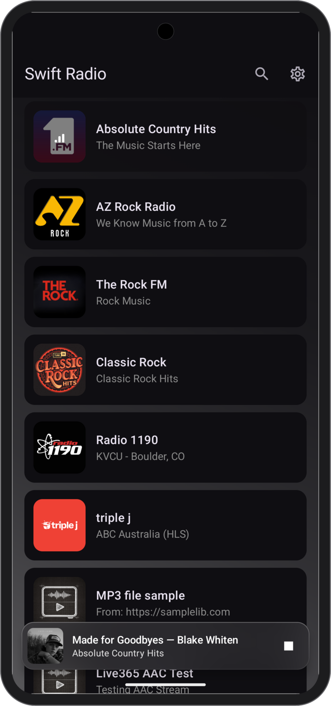
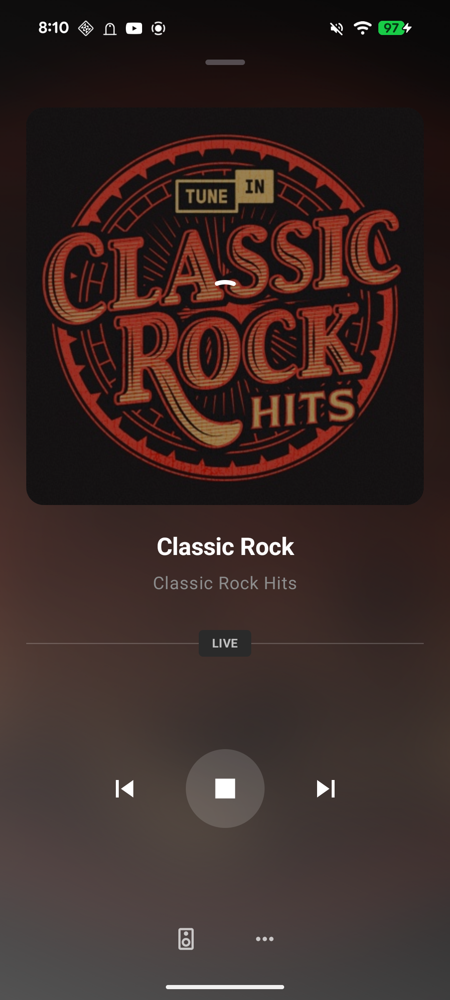

# Sports Radio

An open-source Android radio app tailored for sports fans. Stream radio stations and catch live AFL, NBA, and Premier League scores — all in one place - with Android Auto support.

Forked from [Swift Radio Android](https://github.com/fethica/Swift-Radio-Android) by Fethi, built with Kotlin, Jetpack Compose, and Media3.

<p align="center">
    
    
</p>

## Features

- Stream radio stations with background playback
- Preloaded with a curated selection of Melbourne FM stations
- Live sports scores on the Now Playing screen, notification media session, and Android Auto:
  - **AFL (Australian Rules Football)**: powered by the [Squiggle API](https://squiggle.com.au/) via real-time Server-Sent Events (SSE)
  - **NBA (Basketball)**: powered by the ESPN Scoreboard API with live quarter and clock tracking
  - **Premier League (English Soccer)**: powered by the ESPN Scoreboard API with match period and clock tracking
  - **Mock Provider (Debug builds)**: simulated live game progression for layout and UI testing
- Sport selection in **Settings**: easily switch between sports or disable scores
- Dynamic team logos supplied directly by each score provider
- Smart match completion handling: finished NBA and Premier League games cleanly clear 15 minutes after completion
- Multiple stream URL fallbacks per station for improved playback reliability
- Album art and track metadata from stream headers and the iTunes API
- Google Cast (Chromecast) support
- Android Auto integration with browse tree, playback controls, and artwork
- Lock screen and notification controls with media session artwork
- Back button navigation returns to the main station list before exiting
- Search and filter stations by name or description
- Material You dynamic color support on Android 12+
- Localization-ready with all strings extracted to resources

## Requirements

- Android 8.0+ (API 26)
- Android Studio

## Getting Started

1. Open the project in [Android Studio](https://developer.android.com/studio)
2. Edit `Config.kt` to set your stations URL, contact info, and feature flags
3. Replace `stations/stations.json` with your own stations (hosted or bundled)
4. Build and run

### Station Format

Stations are loaded from a remote JSON file hosted at `https://markcs.github.io/Sports-Radio/stations/stations.json` and user configurable within the app at `Config.stationsURL`. Each station supports the following fields:

```json
{
  "station": [
    {
      "name": "Station Name",
      "streamURLs": [
        "https://example.com/stream.aac",
        "https://example.com/stream.mp3"
      ],
      "imageURL": "https://example.com/station-image.png",
      "desc": "Short description",
      "longDesc": "Detailed description shown in the station info sheet.",
      "website": "https://example.com"
    }
  ]
}
```

| Field        | Required | Description                                                            |
|--------------|----------|------------------------------------------------------------------------|
| `name`       | Yes      | Station name displayed in the list and player                          |
| `streamURLs` | Yes      | Ordered list of stream URLs — the app tries each in turn               |
| `imageURL`   | Yes      | Asset filename (without extension) or a full URL                       |
| `desc`       | Yes      | Short subtitle shown below the station name                            |
| `longDesc`   | No       | Longer description shown in the station info sheet                     |
| `website`    | No       | Station website URL shown in the info sheet                            |

> **Note:** `streamURLs` replaces the original single `streamURL` field. The app falls back through the list automatically if a stream fails to connect. The legacy `streamURL` field is still accepted for compatibility.

### Configuration

All app-wide settings live in `Config.kt`:

```kotlin
object Config {
    val gradientColor: Color = Color.White       // Diagonal gradient overlay color
    const val stationsURL = "https://..."        // Remote stations JSON URL
    const val hideNextPreviousButtons = false    // Hide skip controls on the player
    const val enableSearch = true               // Show/hide search bar on station list
    const val email = "contact@example.com"
    const val feedbackURL = "https://..."
    const val licenseURL = "https://..."
    const val shareText = "Check out Sports Radio!"
}
```

### Live Sports Scores

Sports Radio features a modular live scores system coordinated by `SportsScoreManager` that supports multiple sports providers:

| Sport | Provider / API | Updates | Description |
|---|---|---|---|
| **AFL** | [Squiggle API](https://squiggle.com.au/) | Real-time SSE | Streams live scores, quarters, and scores ticker. Opens around game time and closes when games end. Team logos for all 18 clubs are included. |
| **NBA** | ESPN Scoreboard | Polling | Tracks quarter, clock, timeouts, and live scores. Finished games drop off after 15 minutes. High-resolution team logos loaded via ESPN CDN. |
| **Premier League** | ESPN Scoreboard | Polling | Tracks live match halves, game clock, and scores. Finished fixtures drop off after 15 minutes. Team crests loaded via ESPN CDN. |
| **Mock (Debug)** | In-memory Generator | Simulated | Generates mock live games for testing tickers, logos, and UI transitions without waiting for live match times. |

Users can choose their active sport in the **Settings** menu. Scores appear in a dedicated ticker banner on the Now Playing screen and are dynamically mirrored to media notification metadata and Android Auto.

### Settings & Navigation

The Settings screen is organized into modular sections:
- **Sports**: Select which sport to follow live (AFL, NBA, Premier League, None, or Mock in debug builds).
- **Stations**: Configure custom stations JSON source.
- **About**: View app version, open-source dependencies, and license information.

Predictive back navigation ensures pressing the back button from player or settings screens returns users to the main stations list before exiting the app.

### Station Icons

Station artwork is hosted on GitHub Pages at `https://markcs.github.io/Sports-Radio/stations/icons/` and referenced directly from the stations JSON. Icons for the included Melbourne stations are provided in the `stations/icons/` directory.

### Customizing Text and Translation

All user-facing strings are in `app/src/main/res/values/strings.xml`. To add a new language:

1. Create a new directory: `app/src/main/res/values-XX/` (e.g., `values-fr` for French)
2. Copy `strings.xml` into the new directory
3. Translate the string values

Android will automatically use the correct language based on the user's device settings.

## Dependencies

| Library | Purpose |
|---------|---------|
| [AndroidX Media3](https://developer.android.com/media/media3) | Audio playback, media session, Android Auto |
| [Jetpack Compose](https://developer.android.com/compose) | UI framework with Material 3 |
| [Coil](https://github.com/coil-kt/coil) | Image loading and caching |
| [Ktor](https://github.com/ktorio/ktor) | HTTP client for remote stations, ESPN API, and Squiggle SSE |
| [Kotlinx Serialization](https://github.com/Kotlin/kotlinx.serialization) | JSON parsing |

## Credits

- Forked from [Swift Radio Android](https://github.com/fethica/Swift-Radio-Android) by [Fethi](https://fethica.com)
- Live AFL scores via [Squiggle](https://squiggle.com.au/)
- Live NBA and Premier League scoreboards via [ESPN](https://www.espn.com/)

## License

Sports Radio is open source and available under the [MIT License](LICENSE).
