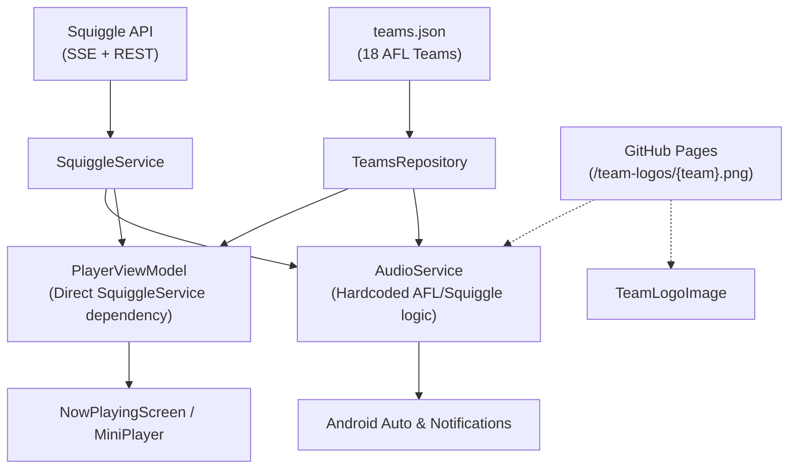

# Architectural Plan: Modular Live Sports Scores for Footy Radio

## 1. Executive Summary

This plan details the modularization of the live scoring system in Footy Radio. Currently, Australian Rules Football (AFL) via the [Squiggle API](https://squiggle.com.au/) is tightly integrated into the audio playback service, view models, and UI components.

By transitioning to a **Sports Provider Architecture**, live scoring becomes sport- and transport-agnostic. Adding new sports (such as NBA, Premier League soccer, or NRL) will require only a single self-contained provider class, without modifying audio playback, Android Auto integration, or core UI code.

---

## 2. Current Architecture vs. Proposed Architecture

### Current Tightly-Coupled State


### Proposed Modular State

```mermaid
flowchart TD
    subgraph Providers ["Modular Sport Providers"]
        Squiggle["SquiggleAflProvider\n(AFL via SSE)"]
        NBA["NbaScoreProvider\n(NBA via REST)"]
        Soccer["SoccerScoreProvider\n(EPL/A-League via REST)"]
        Mock["MockScoreProvider\n(Offline / Debugging)"]
    end

    subgraph Core ["Scores Domain Layer"]
        Interface["interface SportsScoreProvider\n• sportId: String\n• getScoresFlow(): Flow<LiveScoreState?>\n• onActiveScreensChanged(count: Int)"]
        Manager["SportsScoreManager\n• Selected sport routing\n• Lifecycle / active screen proxy\n• Background polling throttling"]
    end

    subgraph Consumers ["Consumers (Sport-Agnostic)"]
        AudioService["AudioService\n(Media3 / Android Auto)"]
        PlayerViewModel["PlayerViewModel\n(Compose UI State)"]
        UI["NowPlayingScreen / MiniPlayer / TeamLogoImage"]
    end

    Squiggle -->|implements| Interface
    NBA -->|implements| Interface
    Soccer -->|implements| Interface
    Mock -->|implements| Interface

    Interface --> Manager
    Manager -->|Flow&#60;LiveScoreState&#62;| AudioService
    Manager -->|Flow&#60;LiveScoreState&#62;| PlayerViewModel
    PlayerViewModel --> UI
```


---

## 3. Core Interface & Domain Model Specifications

### 3.1. Unified State Model
Located at `com.markcs.footyradio.scores.model.LiveScoreState`:

```kotlin
package com.markcs.footyradio.scores.model

data class LiveScoreState(
    val sportId: String,
    val scoreText: String,               // e.g. "COLL (84) v CARL (78) Q4 18:22" or "LAL (108) @ BOS (112) Q4 2:15"
    val homeTeamName: String,
    val awayTeamName: String,
    val homeTeamLogoUrl: String?,        // Direct URL (API crest, CDN, or local asset URI)
    val awayTeamLogoUrl: String?,
    val isLive: Boolean = true,
    val matchStatus: MatchStatus = MatchStatus.LIVE
)

enum class MatchStatus {
    SCHEDULED,
    LIVE,
    PAUSED,       // Half time, quarter time
    FINISHED
}
```

### 3.2. Provider Interface Contract
Located at `com.markcs.footyradio.scores.SportsScoreProvider`:

```kotlin
package com.markcs.footyradio.scores

import com.markcs.footyradio.scores.model.LiveScoreState
import kotlinx.coroutines.flow.Flow

interface SportsScoreProvider {
    val sportId: String                  // e.g. "afl", "nba", "soccer_epl"
    val displayName: String              // User-facing label: "AFL", "NBA", "Premier League"

    /**
     * Emits live scores. Providers internally handle SSE connections, REST polling intervals,
     * or WebSocket streams.
     */
    fun getScoresFlow(enableAbbreviations: Boolean): Flow<LiveScoreState?>

    /**
     * Notifies provider when UI or media controllers are active/inactive.
     * Allows throttling or shutting down connections when not in use.
     */
    fun onActiveScreensChanged(activeCount: Int)
}
```

### 3.3. Orchestrator: `SportsScoreManager`
Located at `com.markcs.footyradio.scores.SportsScoreManager`:

```kotlin
package com.markcs.footyradio.scores

import android.content.Context
import com.markcs.footyradio.scores.model.LiveScoreState
import kotlinx.coroutines.CoroutineScope
import kotlinx.coroutines.flow.*

class SportsScoreManager(
    private val context: Context,
    private val providers: Map<String, SportsScoreProvider>,
    private val scope: CoroutineScope
) {
    private val prefs = context.getSharedPreferences("footy_radio_prefs", Context.MODE_PRIVATE)
    
    private val _selectedSport = MutableStateFlow(
        prefs.getString("selected_sport_id", "afl") ?: "afl"
    )
    val selectedSport: StateFlow<String> = _selectedSport.asStateFlow()

    private val _enableAbbreviations = MutableStateFlow(
        prefs.getBoolean("enable_team_abbreviations", false)
    )
    val enableAbbreviations: StateFlow<Boolean> = _enableAbbreviations.asStateFlow()

    fun getAvailableSports(): List<Pair<String, String>> =
        providers.values.map { it.sportId to it.displayName }

    fun setSport(sportId: String) {
        if (providers.containsKey(sportId) || sportId == "none") {
            prefs.edit().putString("selected_sport_id", sportId).apply()
            _selectedSport.value = sportId
        }
    }

    fun setAbbreviationsEnabled(enabled: Boolean) {
        prefs.edit().putBoolean("enable_team_abbreviations", enabled).apply()
        _enableAbbreviations.value = enabled
    }

    // Active live score stream switching automatically when user changes sport
    val liveScoreFlow: StateFlow<LiveScoreState?> = combine(
        _selectedSport,
        _enableAbbreviations
    ) { sportId, abbr ->
        sportId to abbr
    }.flatMapLatest { (sportId, abbr) ->
        val provider = providers[sportId]
        provider?.getScoresFlow(abbr) ?: flowOf(null)
    }.stateIn(
        scope = scope,
        started = SharingStarted.WhileSubscribed(5000),
        initialValue = null
    )

    fun onActiveScreensChanged(count: Int) {
        providers[_selectedSport.value]?.onActiveScreensChanged(count)
    }
}
```

---

## 4. Planned Changes by Component

### A. [`SwiftRadioApplication.kt`](file:///home/mark/git/Footy-Radio/app/src/main/java/com/markcs/footyradio/SwiftRadioApplication.kt)
- Replace direct `squiggleService` singleton with:
  ```kotlin
  val sportsScoreManager: SportsScoreManager by lazy { ... }
  ```
- Register the default map of providers (`SquiggleAflProvider`, `NbaScoreProvider`, `SoccerScoreProvider`).

### B. [`SquiggleService.kt`](file:///home/mark/git/Footy-Radio/app/src/main/java/com/markcs/footyradio/data/SquiggleService.kt) $\to$ `SquiggleAflProvider.kt`
- Move from `data/` to `scores/providers/SquiggleAflProvider.kt`.
- Implement `SportsScoreProvider`.
- Inject or encapsulate AFL team abbreviation lookups.
- Return `LiveScoreState` with full logo URLs:
  `"https://markcs.github.io/Sports-Radio/team-logos/${team}.png"`.

### C. [`AudioService.kt`](file:///home/mark/git/Footy-Radio/app/src/main/java/com/markcs/footyradio/AudioService.kt)
- Remove `SquiggleService` import, `startSquigglePolling()`, and `stopSquigglePolling()`.
- Listen to `app.sportsScoreManager.liveScoreFlow`.
- Update [`applyTeamLogoArtwork()`](file:///home/mark/git/Footy-Radio/app/src/main/java/com/markcs/footyradio/AudioService.kt#L1190):
  Instead of hardcoding the GitHub URL using AFL team names, use `liveScore.homeTeamLogoUrl` and `liveScore.awayTeamLogoUrl` directly.

### D. [`PlayerViewModel.kt`](file:///home/mark/git/Footy-Radio/app/src/main/java/com/markcs/footyradio/PlayerViewModel.kt)
- Replace `squiggleService` and `teamsRepository` parameters with `sportsScoreManager`.
- Collect `sportsScoreManager.liveScoreFlow`.
- Add actions to switch sports (`sportsScoreManager.setSport(id)`).

### E. [`TeamLogoImage.kt`](file:///home/mark/git/Footy-Radio/app/src/main/java/com/markcs/footyradio/ui/components/TeamLogoImage.kt)
- Update composable parameters from `hTeam: String?`, `aTeam: String?` to `homeLogoUrl: String?`, `awayLogoUrl: String?`.
- Supports any image URL provided by any sport provider directly.

### F. [`AboutScreen.kt`](file:///home/mark/git/Footy-Radio/app/src/main/java/com/markcs/footyradio/ui/AboutScreen.kt)
- Add a "Live Scores Sport" preference picker (AFL, NBA, Premier League, Off) under the Settings section.

---

## 5. Implementation Roadmap

### Phase 1: Foundation & Abstraction (Zero Regression for AFL)
1. Create `com.markcs.footyradio.scores.model.LiveScoreState`.
2. Define `SportsScoreProvider` interface.
3. Wrap existing `SquiggleService` into `SquiggleAflProvider : SportsScoreProvider`.
4. Create `SportsScoreManager` and inject it in `SwiftRadioApplication`.
5. Point `PlayerViewModel` and `AudioService` to `SportsScoreManager`.
6. Verify AFL live scores, notifications, and team logos continue to work unchanged.

### Phase 2: Logo Decoupling
1. Update `TeamLogoImage.kt` to consume direct logo URLs.
2. Update `AudioService.applyTeamLogoArtwork()` to load logos from URLs provided in `LiveScoreState`.
3. Verify AFL team logos load correctly across both Now Playing screen and Android Auto.

### Phase 3: Settings & Sport Selection UI
1. Add `selected_sport_id` to shared preferences.
2. Add a sport selector in `AboutScreen.kt` (Dropdown or Radio selection: AFL, None, etc.).
3. Wire dynamic switching in `SportsScoreManager`.

### Phase 4: Additional Sport Providers
1. **NBA Provider (`NbaScoreProvider`)**:
   - Source: Balldontlie / ESPN Public Scoreboard.
   - Polling engine with backoff when no games are active.
   - Formatter: `LAL 108 @ BOS 112 (Q4 2:15)`.
2. **Soccer Provider (`SoccerScoreProvider`)**:
   - Source: Football-Data.org / API-Football.
   - Formatter: `ARS 2 - 1 CHE (78')`.
   - Direct club crest URLs passed in state.
3. **Mock Provider (`MockScoreProvider`)**:
   - Emits synthetic games for testing UI and Android Auto layout without waiting for game day.

---

## 6. API Considerations & Risk Mitigation

| Sport / API | Transport | Rate Limits | Mitigation |
| :--- | :--- | :--- | :--- |
| **AFL (Squiggle)** | SSE (Push) + REST | Unlimited / Free | Existing logic; auto-connects 5 min before match. |
| **NBA (Balldontlie / ESPN)** | REST Polling | Free tier: 30-60 req/min | Poll every 30s only during active game clock hours; delay 10-15 min otherwise. |
| **Soccer (Football-Data.org)** | REST Polling | Free tier: 10 req/min | Poll every 60s only during match periods; disable polling overnight. |
| **Power Management** | Coroutine scope | Android background limits | Use `onActiveScreensChanged()` to halt or slow polling when app is idle or paused. |
